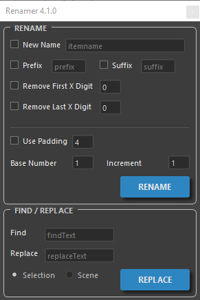

### 3DSMAX Style Renamer for AutodeskMaya

A renamer/replace tool based on the 3dsmax renamer.

Supports maya undo. (Ctrl + Z)  
There are some limitations from the maya naming system, you cannot have a number prefix, or duplicated names in the same hierarchy.  
You can rename maya non-DAG Objects, like shading nodes, etc, from the outliner.  
The auto-padding feature works reading the selection order, if you want the same results on padding, just select items in the same order. (Select Top item, shift-click and select bottom item)



### Install

Maya 2025+ *Python3 PySide6* (PySide2 / older Maya versions are no longer supported)

Download and add the folder to your PYTHONPATH environment variable or copy into your maya/scripts folder.

PYTHONPATH += *'D:\directory'* (the folder that contains the `renamer` package)

### Run

Create a shelf button with this python command:
```python
import renamer.main as renamer
renamer.load()
```

### Tests

The pure naming logic (`renamer/naming.py`) has no Maya dependency:
```
python -m pip install pytest
python -m pytest tests
```
